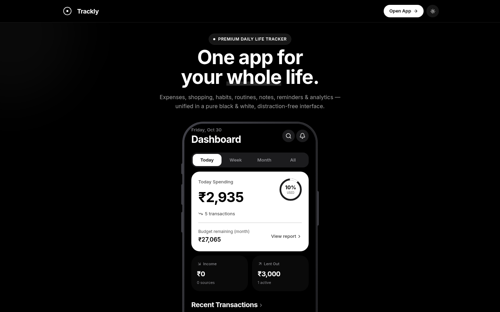
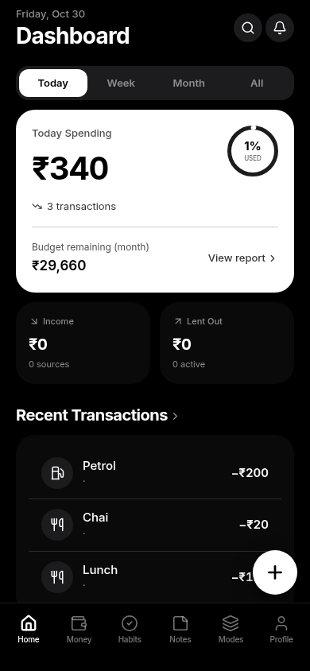
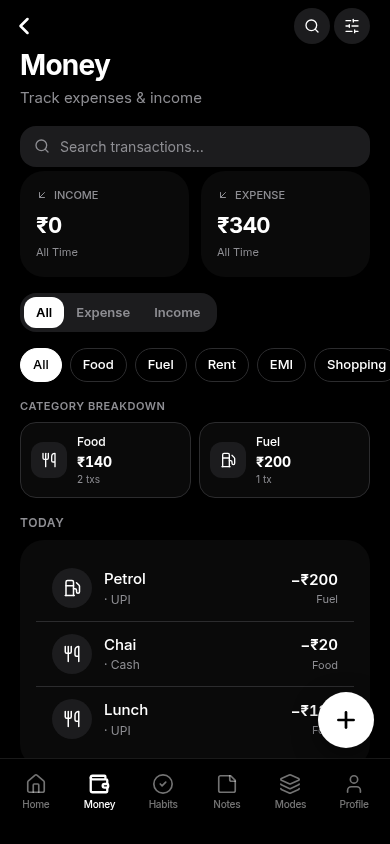

<div align="center">


# Trackly

**One app for your whole life — money, habits, notes & an AI that understands Hinglish.**

[](https://trackly.today)
[](https://nextjs.org)
[](https://supabase.com)
[](https://web.dev/progressive-web-apps/)
[](https://www.typescriptlang.org)

[Live App](https://trackly.today) · [Features](https://trackly.today/features) · [Blog](https://trackly.today/blog)

</div>

---

Trackly is a free, offline-first, all-in-one daily life tracker built as a **Progressive Web App** — it installs on any phone in about 30 seconds, without an app store, and works fully offline. Made in India, for the way we actually talk: its built-in AI assistant understands both English and **Hinglish** — say *"add momo 70, biryani 78"* and the entries appear.

## Screenshots

| Landing | Dashboard | Money |
|:---:|:---:|:---:|
|  |  |  |

## Features

- 💸 **Money tracking** — expenses, income, budgets, borrow/lend (udhaar) tracking, per-category breakdowns, INR-native
- ✅ **Habits & routines** — daily habits with streaks, routines, medicine reminders
- 📝 **Notes & tasks** — quick notes, to-dos, shopping lists, trash & archive
- 👥 **Group expenses** — Splitwise-style splitting for roommates & trips, with settlements
- 🤖 **AI assistant** — natural-language quick-add in English & Hinglish, with a fair daily quota and a referral program to earn more
- 🎓 **Student & Office modes** — assignments, exams, hostel rent, attendance, salary finance
- 📶 **Offline-first PWA** — install in ~30 seconds from the browser, works without a network, syncs when back online
- 🔐 **Privacy-first** — Supabase Row-Level Security on every table; your data is yours
- 🌙 **Dark mode** — pure-black theme tuned for OLED phones

## Tech Stack

| Layer | Tech |
| --- | --- |
| Framework | Next.js 16 (App Router, Turbopack), React 19, TypeScript |
| Styling | Tailwind CSS, Framer Motion |
| Backend | Next.js Route Handlers (Node runtime) |
| Database & Auth | Supabase (Postgres, RLS, Auth) |
| Admin analytics | Prisma + Postgres |
| Hosting | Vercel |
| AI | Z.ai GLM (via z-ai-web-dev-sdk) |

## Project Structure

```
src/
├── app/               # App Router pages + API routes
│   ├── app/           # The PWA shell (client app)
│   ├── api/           # Route handlers (AI, referrals, admin, …)
│   ├── blog/          # SEO content engine (11 articles + sitemap)
│   └── …              # Landing, /install, SEO keyword pages
├── components/
│   ├── trackly/       # All app screens (Dashboard, Expenses, Habits, …)
│   └── admin/         # Admin dashboard (NextAuth-protected)
└── lib/               # Supabase clients, utils
prisma/                # Admin analytics schema
public/                # PWA icons, manifest, creatives
```

## Local Development

```bash
git clone https://github.com/cyberamxn/trackly-app.git
cd trackly-app
npm install            # or: bun install
cp .env.example .env   # fill in your Supabase keys
npm run dev            # http://localhost:3000
```

Environment variables needed (see `.env.example`):

```
NEXT_PUBLIC_SUPABASE_URL=      # your Supabase project URL
NEXT_PUBLIC_SUPABASE_ANON_KEY= # public (anon) key — client-safe
SUPABASE_SERVICE_ROLE_KEY=     # server-only, never exposed to the client
DATABASE_URL=                  # Postgres connection (admin analytics)
NEXTAUTH_SECRET=               # admin session secret
```

## Security Notes

- Every user table is protected by **Row-Level Security**; the service-role key is only ever used in server-side route handlers.
- The admin dashboard sits behind **NextAuth credentials + scrypt password hashing + optional 2FA**.
- No secrets are committed — everything sensitive lives in environment variables (Vercel).

## Contributing

Issues and PRs are welcome. For major changes, please open an issue first to discuss what you'd like to change.

## License

Released under the [MIT License](LICENSE) — free to use, learn from, and build upon.

---

<div align="center">

Made with ❤️ by [ahexa.studio](https://ahexa.studio) · [trackly.today](https://trackly.today)

</div>
